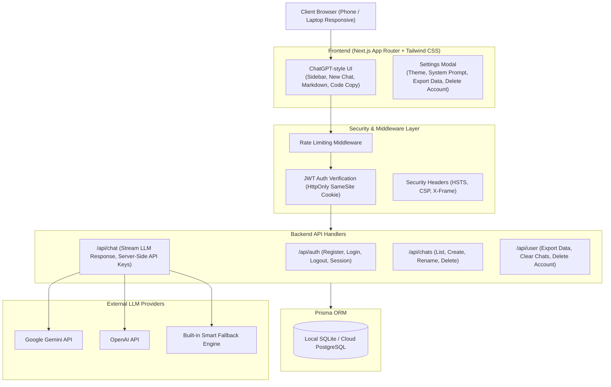

# Implementation Plan: UMGN - Secure Personal AI Chatbot Web App

UMGN is a production-ready, highly secure personal AI chatbot web application inspired by ChatGPT. It features a modern responsive UI (desktop sidebar + mobile drawer), server-side LLM orchestration with zero API key exposure, user authentication, chat history persistence with a relational database, user data export and deletion compliance, rate limiting, and automated HTTPS cloud deployment configurations.

## User Review Required

> [!IMPORTANT]
> **API Provider & Fallback:** The backend will support server-side Google Gemini (`GEMINI_API_KEY`) and OpenAI (`OPENAI_API_KEY`) via `.env.local`. If no external API key is provided immediately during local testing, UMGN includes a built-in intelligent fallback assistant engine so you can test and use the app out of the box.
>
> **Database Architecture:** Built on **Prisma ORM** with SQLite by default for instant zero-dependency local setup (supporting 10–50 users easily). It is architected so switching to PostgreSQL (e.g., Supabase, Neon, AWS RDS) for high-scale multi-user production requires only changing `DATABASE_URL` and `provider = "postgresql"` in `schema.prisma`.

---

## Key Features & Architecture

---

## Proposed Changes

### 1. Project Initialization & Dependencies
- Scaffold Next.js 14/15 with TypeScript, Tailwind CSS, Lucide icons, Prisma, bcryptjs, jose (JWT), and react-markdown.
- Setup `package.json`, `tsconfig.json`, `tailwind.config.ts`, `postcss.config.js`, and `next.config.mjs` with strict security headers.

#### [NEW] [package.json](file:///c:/Users/LENOVO/Documents/ud/package.json)
#### [NEW] [tsconfig.json](file:///c:/Users/LENOVO/Documents/ud/tsconfig.json)
#### [NEW] [tailwind.config.ts](file:///c:/Users/LENOVO/Documents/ud/tailwind.config.ts)
#### [NEW] [next.config.mjs](file:///c:/Users/LENOVO/Documents/ud/next.config.mjs)
#### [NEW] [.env.example](file:///c:/Users/LENOVO/Documents/ud/.env.example)

---

### 2. Database Layer (Prisma ORM)
- Define relational schema:
  - `User`: Credentials, creation timestamp, cascade delete relations.
  - `UserSettings`: Persona/system instructions, preferred model, temperature, theme.
  - `Chat`: Title, timestamps, user ownership.
  - `Message`: Role (`user` | `assistant` | `system`), content, timestamps.
- Prisma client singleton with connection pooling protection for Next.js hot-reloading.

#### [NEW] [schema.prisma](file:///c:/Users/LENOVO/Documents/ud/prisma/schema.prisma)
#### [NEW] [db.ts](file:///c:/Users/LENOVO/Documents/ud/src/lib/db.ts)

---

### 3. Authentication & Security Engine
- Password hashing with `bcryptjs` (salt rounds: 12).
- Stateless JWT issuance and verification using `jose` with `HS256`.
- Secure cookie helpers (`HttpOnly`, `SameSite=Strict`, `Secure` in production, `Path=/`).
- Sliding window in-memory rate limiting to prevent credential stuffing and API abuse.
- Security headers (HSTS, CSP, X-Frame-Options: DENY, X-Content-Type-Options: nosniff).

#### [NEW] [auth.ts](file:///c:/Users/LENOVO/Documents/ud/src/lib/auth.ts)
#### [NEW] [rate-limit.ts](file:///c:/Users/LENOVO/Documents/ud/src/lib/rate-limit.ts)
#### [NEW] [middleware.ts](file:///c:/Users/LENOVO/Documents/ud/src/middleware.ts)

---

### 4. Backend API Routes
- **Authentication**:
  - `POST /api/auth/register`: Create account with username, email, password; auto-initialize default settings.
  - `POST /api/auth/login`: Authenticate and set HttpOnly JWT cookie.
  - `POST /api/auth/logout`: Clear auth cookie.
  - `GET /api/auth/me`: Get current authenticated user profile & settings.
- **Chat Management**:
  - `GET /api/chats`: List user chats ordered by recent update with message counts.
  - `POST /api/chats`: Create a new chat session.
  - `GET /api/chats/[id]`: Retrieve full message history for a chat.
  - `PATCH /api/chats/[id]`: Rename chat title.
  - `DELETE /api/chats/[id]`: Delete specific chat.
- **Chat Streaming**:
  - `POST /api/chat/stream`: Stream AI completion using server-side API keys (`GEMINI_API_KEY` or `OPENAI_API_KEY`) with graceful fallback engine. Saves both user prompt and assistant response to database atomically.
- **User Privacy & Data Rights**:
  - `GET /api/user/export`: Export complete user data (profile, settings, all chats and messages) in structured JSON format.
  - `DELETE /api/user/chats`: Delete all chats and message history for the user.
  - `DELETE /api/user/account`: Permanently delete user account and all associated data.
  - `PATCH /api/user/settings`: Update system prompt, model preference, temperature.

#### [NEW] [route.ts (Register)](file:///c:/Users/LENOVO/Documents/ud/src/app/api/auth/register/route.ts)
#### [NEW] [route.ts (Login)](file:///c:/Users/LENOVO/Documents/ud/src/app/api/auth/login/route.ts)
#### [NEW] [route.ts (Logout)](file:///c:/Users/LENOVO/Documents/ud/src/app/api/auth/logout/route.ts)
#### [NEW] [route.ts (Me)](file:///c:/Users/LENOVO/Documents/ud/src/app/api/auth/me/route.ts)
#### [NEW] [route.ts (Chats)](file:///c:/Users/LENOVO/Documents/ud/src/app/api/chats/route.ts)
#### [NEW] [route.ts (Chat ID)](file:///c:/Users/LENOVO/Documents/ud/src/app/api/chats/[id]/route.ts)
#### [NEW] [route.ts (Chat Stream)](file:///c:/Users/LENOVO/Documents/ud/src/app/api/chat/stream/route.ts)
#### [NEW] [route.ts (User Data Export)](file:///c:/Users/LENOVO/Documents/ud/src/app/api/user/export/route.ts)
#### [NEW] [route.ts (User Account Delete)](file:///c:/Users/LENOVO/Documents/ud/src/app/api/user/account/route.ts)
#### [NEW] [route.ts (User Settings)](file:///c:/Users/LENOVO/Documents/ud/src/app/api/user/settings/route.ts)

---

### 5. Frontend Chat UI (ChatGPT-Style Experience)
- **Design System & Theme**:
  - Dark mode by default (sleek ChatGPT gray `#202123` / `#343541` aesthetic) with smooth toggle for light mode.
- **Sidebar Component**:
  - App logo: **UMGN** with subtitle "Personal AI".
  - "New chat" button with shortcut hint.
  - Chronological chat history groupings: *Today*, *Yesterday*, *Previous 7 Days*, *Older*.
  - Chat action popovers: Rename title, Delete conversation.
  - Responsive drawer toggle for smartphones and tablets.
  - User footer with avatar, username, and quick access to Settings Modal and Logout.
- **Chat Viewport**:
  - Empty state with prompt suggestions (Coding, Writing, Analysis, Brainstorming).
  - Message stream with Markdown formatting, syntax highlighting, language badge, and one-click "Copy Code".
  - Assistant avatar with streaming cursor and "Stop generating" option.
  - Action buttons on messages (Copy message text, Regenerate).
  - Auto-resizing textarea with Enter-to-send and Shift+Enter for newlines.
- **Settings Modal**:
  - **General**: Username display, Theme toggle (Dark / Light).
  - **Model & Persona**: System prompt customization, model selection, temperature slider.
  - **Data Controls & Privacy**: One-click "Export All Data (JSON)", "Clear All Chats", and danger-zone "Delete Account".
  - **Privacy Guarantee**: Visual badge confirming no unnecessary tracking or third-party telemetry.
- **Auth Modals / Pages**:
  - Sleek Login & Registration view with input validation and error feedback.

#### [NEW] [layout.tsx](file:///c:/Users/LENOVO/Documents/ud/src/app/layout.tsx)
#### [NEW] [page.tsx](file:///c:/Users/LENOVO/Documents/ud/src/app/page.tsx)
#### [NEW] [globals.css](file:///c:/Users/LENOVO/Documents/ud/src/app/globals.css)
#### [NEW] [Sidebar.tsx](file:///c:/Users/LENOVO/Documents/ud/src/components/Sidebar.tsx)
#### [NEW] [ChatArea.tsx](file:///c:/Users/LENOVO/Documents/ud/src/components/ChatArea.tsx)
#### [NEW] [ChatMessage.tsx](file:///c:/Users/LENOVO/Documents/ud/src/components/ChatMessage.tsx)
#### [NEW] [SettingsModal.tsx](file:///c:/Users/LENOVO/Documents/ud/src/components/SettingsModal.tsx)
#### [NEW] [AuthModal.tsx](file:///c:/Users/LENOVO/Documents/ud/src/components/AuthModal.tsx)

---

### 6. Cloud & Production Readiness (Scalability & HTTPS)
- Multi-stage `Dockerfile` optimized for standalone Next.js deployment.
- `docker-compose.yml` configured with Caddy reverse proxy for automated Let's Encrypt SSL/HTTPS.
- Production deployment guide (`DEPLOYMENT.md`) explaining how to host on cloud VPS (AWS, GCP, DigitalOcean, Hetzner) and scale from 10 users to 10,000+ users with PostgreSQL.

#### [NEW] [Dockerfile](file:///c:/Users/LENOVO/Documents/ud/Dockerfile)
#### [NEW] [docker-compose.yml](file:///c:/Users/LENOVO/Documents/ud/docker-compose.yml)
#### [NEW] [Caddyfile](file:///c:/Users/LENOVO/Documents/ud/Caddyfile)
#### [NEW] [DEPLOYMENT.md](file:///c:/Users/LENOVO/Documents/ud/DEPLOYMENT.md)

---

## Verification Plan

### Automated Tests & Checks
1. **TypeScript Compilation & Build Verification**:
   - Run `npx tsc --noEmit` to verify type safety across all components and API handlers.
   - Run `npm run build` to ensure the production bundle builds without errors.
2. **Database Migration Check**:
   - Run `npx prisma db push` or `npx prisma generate` to ensure SQLite schema initializes properly.
3. **API & Endpoints Verification**:
   - Test user registration with password hashing.
   - Test login and JWT cookie generation.
   - Test chat creation and message storage.
   - Test streaming chat endpoint (`/api/chat/stream`).
   - Test user data export (`/api/user/export`) and verify JSON output format.
   - Test chat deletion and account deletion cascade.

### Manual Verification
1. Launch development server (`npm run dev`) and test on desktop browser.
2. Test responsive mobile drawer on small viewport widths.
3. Verify dark mode aesthetic matches ChatGPT-style UI.
4. Verify code block formatting, copy buttons, and message streaming.
